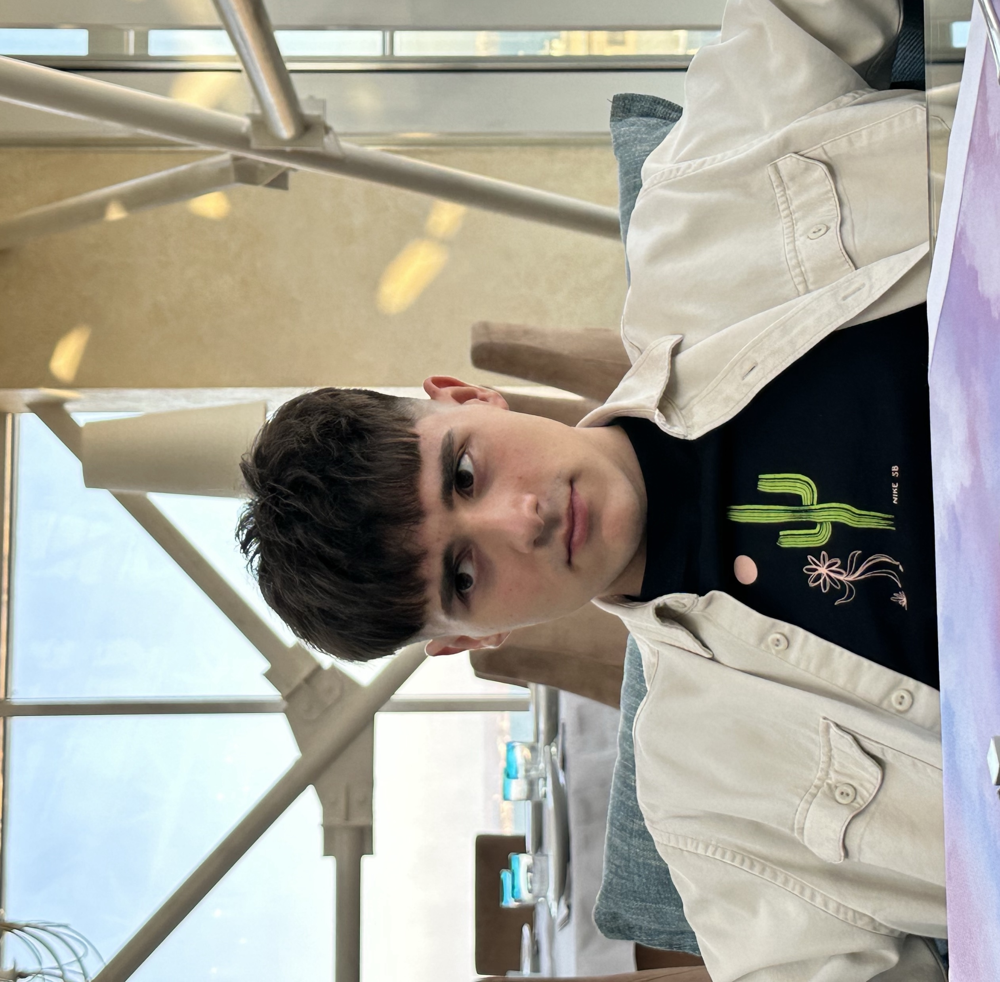

<p align="center">
  
</p>

<h1 align="center">Taras Poiatsyka · Developer Portfolio</h1>

<p align="center">Full-Stack Software Engineer · React, TypeScript &amp; Node.js</p>

<p align="center">
  <a href="https://taras-portfolio-theta.vercel.app"><strong>Live portfolio ↗</strong></a>
  · <a href="https://taras-portfolio-theta.vercel.app/projects">Projects</a>
  · <a href="https://www.linkedin.com/in/poiatsyka/">LinkedIn</a>
</p>

## About

My portfolio brings together my commercial experience building web and desktop applications, selected personal projects, and a downloadable résumé. The project gallery links to source code and live demos, and the contact form is available for project inquiries and job opportunities.

## Built with

**Next.js App Router** · **React** · **TypeScript** · **Tailwind CSS** · **Resend**

The site includes light and dark themes, a circular theme transition, and support for the system’s reduced-motion preference.

## Run locally

Use Node.js 20.9 or newer. From the repository root, run:

```bash
npm ci
npm run dev
```

Open [localhost:3000](http://localhost:3000).

To enable email delivery through the contact form, add your Resend API key to `.env.local`:

```dotenv
RESEND_API_KEY=your_resend_api_key
```

The rest of the site runs without the key.
